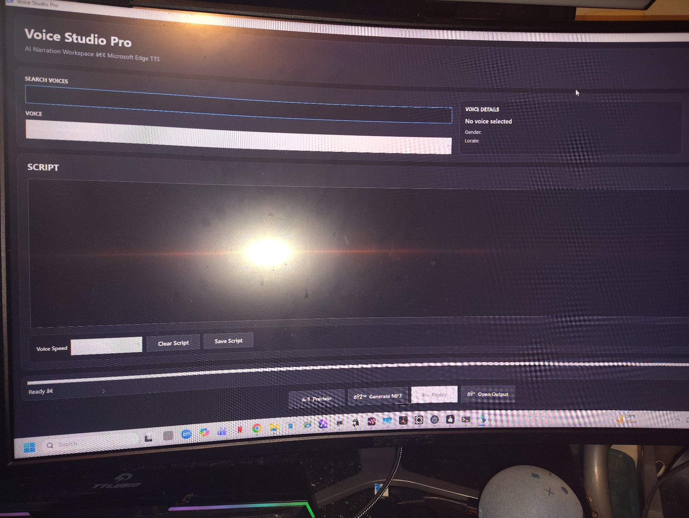

# Voice Studio Pro

**AI narration workspace for Windows** — an Electron desktop app that wraps the Microsoft Edge text-to-speech engine (the same neural voices behind Edge's Read Aloud) in a dedicated narration studio: pick a voice, paste a script, export an MP3. No browser tab, no command line, no subscription TTS service.

## Overview

Voice Studio Pro was built for faceless content narration. The usual options for Microsoft's neural voices are reading a web page aloud in a browser or scripting a TTS library from the terminal — neither is a narration workflow. Voice Studio Pro puts the whole job in one window: a searchable voice catalog, a script editor, playback controls, and one-click MP3 export.

- **Current build:** version 0.5.6, Windows x64
- **Form factor:** compiled Electron application (`.exe`)
- **Repository type:** project showcase — the compiled build is available on request; application source code is not published in this repository

## Screenshot

*The main workspace: voice search and picker on top, voice details panel, script editor, and the Preview / Generate MP3 / Replay / Open Output transport bar.*

## Features

- **Voice selection** — a searchable picker over the Microsoft Edge TTS voice catalog. Type to filter by name, language, or region; selecting a voice populates the details panel with its **gender** and **locale**, so you know exactly which voice you are rendering with before you commit to it.
- **Script editing** — a full-width script editor for pasting or writing narration text, with **Save Script** (persist the script to a file) and **Clear Script** (start over without selecting text by hand).
- **Speed control** — a voice-speed setting applied at render time, for tightening up a read or slowing it down for emphasis without re-recording anything.
- **Audio preview** — audition the selected voice against the current script before exporting, so a wrong voice or a typo is caught in seconds instead of after a full render.
- **MP3 generation** — render the script with the selected voice and speed to an MP3 file, ready to drop into a video editor.
- **Replay** — re-play the most recent render from inside the app to check the take.
- **Open Output** — jump straight to the exported file in the output folder from the transport bar; no hunting through Explorer.
- **Status bar** — reports the app state (e.g. "Ready", rendering, done), so long scripts never leave you guessing whether it's working.

## Architecture

Voice Studio Pro is an **Electron** application: a Chromium-based workspace UI hosted in a native Windows shell.

- **Electron shell (main process)** — owns the application window, native file dialogs (save script, locate output), and local file access for writing exported MP3s. This is the part a browser tab can't do cleanly.
- **Workspace UI (renderer)** — a single-page interface with three regions: the voice picker + details panel, the script editor, and the transport bar (Preview / Generate MP3 / Replay / Open Output). All state — selected voice, script text, speed — lives in the workspace and is passed to the shell at render time.
- **Microsoft Edge TTS integration** — when you preview or generate, the shell sends the script text, the selected voice identifier, and the speed setting to Microsoft's Edge text-to-speech service — the same cloud service that powers Read Aloud in the Edge browser — and streams the synthesized neural-voice audio back. Preview plays that audio in-app; **Generate MP3** writes it to the output file. The voices are not bundled with the app and are not generated locally: synthesis happens on Microsoft's service, which is why the catalog always matches what Edge itself offers.

## Setup

1. Obtain the compiled build (`VoiceStudio-Electron-0.5.6-win-x64.exe`) — available on request from the author.
2. Run the `.exe`. There is no separate installer step and no account to create.
3. You need an **internet connection** at render time: voice synthesis is performed by Microsoft's Edge TTS service (see *Service dependencies* below).

### Dependencies

| Dependency | Notes |
|---|---|
| Windows 10/11 (x64) | The published build targets 64-bit Windows |
| Electron runtime | Bundled inside the compiled build — nothing to install separately |
| Internet connection | Required for synthesis; the voice catalog and audio come from Microsoft's service |
| Audio output device | Any standard Windows playback device, for Preview/Replay |

## Usage

1. **Pick a voice** — search the catalog, select a voice, confirm gender/locale in the details panel.
2. **Write or paste the script** in the editor. Use **Save Script** to keep a copy.
3. **Set the speed** if the default pace doesn't fit the content.
4. **Preview** to hear the voice on your actual words.
5. **Generate MP3** to render the final narration file.
6. **Replay** to check the take, **Open Output** to grab the file for your editor.

## Known limitations

- **Internet required** — if Microsoft's TTS service can't be reached, voices won't load and renders can't complete. There is no offline voice engine.
- **The voice catalog is Microsoft's** — voices can be added, renamed, or retired by Microsoft at any time; the app reflects the catalog as served.
- **Unsigned build** — the `.exe` is not code-signed, so Windows SmartScreen may warn on first run (see Troubleshooting).
- **Showcase repository** — this repo documents the project and hosts its screenshot; it does not contain the application source or a downloadable release.

## Troubleshooting

- **No voices appear in the picker** — check the internet connection first; the catalog is fetched from Microsoft's service at runtime. Restart the app after reconnecting.
- **Preview is silent** — confirm a voice is actually selected (the details panel should show its gender/locale), and check the Windows output device and volume. Use **Replay** to re-test the last render without re-rendering.
- **Generate MP3 produces no file** — make sure the script editor isn't empty, then check that the output folder is writable and has disk space. **Open Output** confirms where files are being written.
- **Windows SmartScreen blocks the first launch** — the build is unsigned. If you obtained the `.exe` directly from the author, choose **More info → Run anyway**.
- **Status bar doesn't say "Ready"** — a render or preview is still in progress; long scripts take longer to synthesize. Wait for the status to settle before starting another render.

## Service dependencies & licensing considerations

- **Microsoft Edge TTS is a third-party service dependency.** The neural voices are Microsoft's, served under Microsoft's terms for that service. Voice Studio Pro is a wrapper/client around it — it does not redistribute Microsoft's voices, models, or service, and using the app means your script text is sent to Microsoft's service for synthesis. Availability and terms are Microsoft's to change.
- **Electron** is used under its open-source license (MIT).
- **License: TBD by author** — no license file is included in this repository yet; all rights are reserved by the author until one is added.
